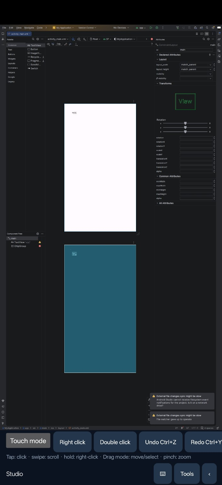
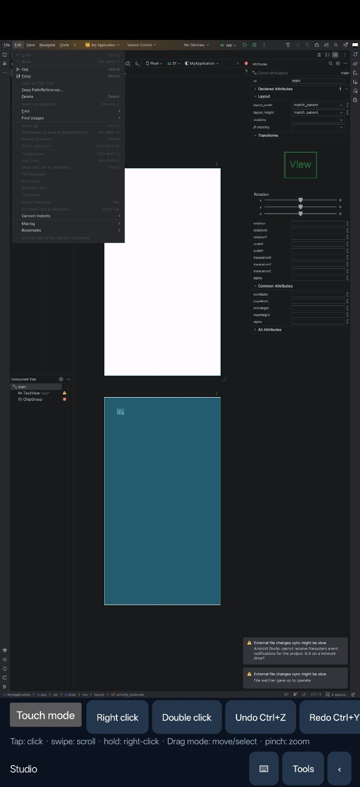
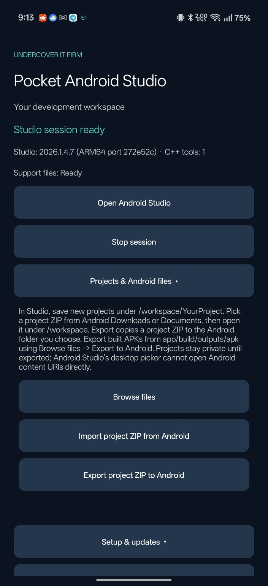
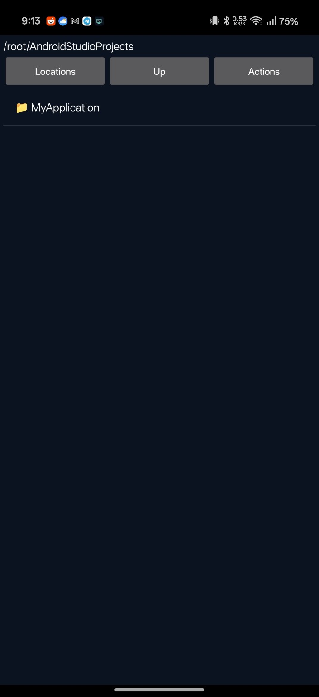
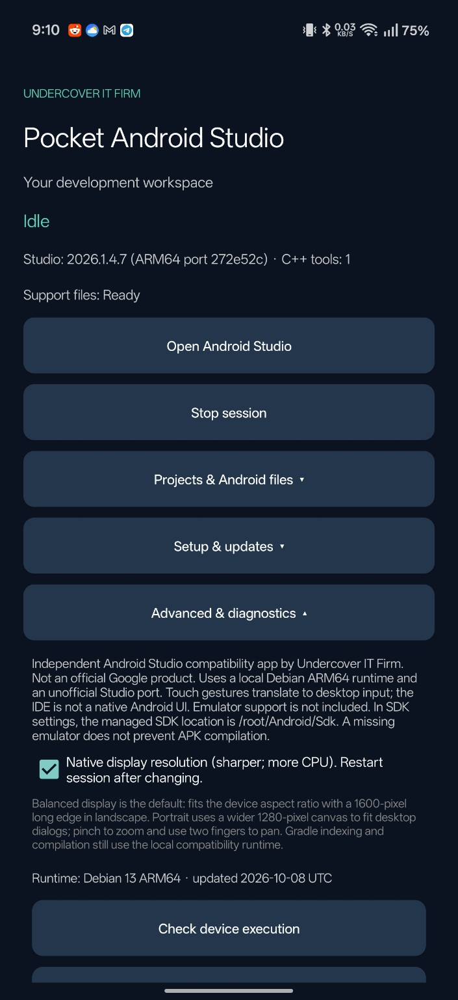

# Pocket Android Studio

Android development on your ARM64 Android device, by **Undercover IT Firm**.

Pocket Android Studio runs desktop Android Studio through a local Linux compatibility runtime, with touch controls and Android file integration. This repository distributes the APK and documentation. Application source code is not included.

**Download:** Open this repository’s **Releases** section and download `PocketAndroidStudio-0.2.10_sign.apk` from **Assets**. GitHub’s automatic “Source code” ZIP/TAR downloads contain only this repository’s documentation and screenshots, not the APK or application source.

## Screenshots

Actual device screenshots supplied for this release; originals are included unchanged.

| Studio layout editor | Edit menu and touch shortcuts |
| --- | --- |
|  |  |

| Projects and Android files | File browser | Advanced and diagnostics |
| --- | --- | --- |
|  |  |  |

The Studio screenshots show filesystem-watcher warnings. They demonstrate the running interface; they do not certify all warnings resolved, successful APK compilation, or a connected deployment device.

## Features

- Automatic runtime setup and verified component downloads.
- Managed Android Studio installation and compatibility-aware update checks.
- Local Java provisioning, including a full ARM64 JDK 25 for matching Gradle requirements.
- Touch scrolling, pinch zoom, drag mode, double-click and keyboard shortcuts.
- Android text clipboard integration and browser handoff for sign-in links.
- File browsing, copy/move/rename, text editing and recoverable deletion.
- Import projects from Android storage and export files or project ZIPs through Android’s picker.
- Diagnostics with manual refresh and optional live updates.

## Install and start

1. Download the APK from Releases and allow installation from your chosen installer if Android asks.
2. Install the APK. Export important projects before updating. This upload uses a different signer from the previously supplied APK, so it cannot update that differently signed installation in place. Keep using this signing identity for subsequent releases. Back up projects before any uninstall; uninstalling deletes private runtime data.
3. Open Pocket Android Studio, review the linked download terms and run setup with a reliable connection and sufficient free storage.
4. Use Pocket’s Install/Update control, then open Studio. First setup downloads several gigabytes; optional C/C++ tooling requires more storage.
5. Create or import a project under `/workspace`. The managed SDK location is `/root/Android/Sdk` inside the runtime.

## Files and backups

Use the Android picker to import projects from Downloads/Documents. Build the imported local copy. Export files or project ZIPs to Android storage for backups and sharing. Arbitrary document-provider folders are not directly mounted into Studio. Uninstalling or clearing app data removes the private runtime and unexported projects.

## Compatibility and current limits

- Requires an ARM64 Android device; desktop workloads can consume substantial RAM, storage and battery.
- Android can warn about the older target SDK, used by the current compatibility execution architecture.
- Install/Update checks the latest stable Studio release but activation requires a matching ARM64 compatibility profile. Availability can lag upstream releases. Use Pocket’s updater rather than Studio’s stock patcher.
- Android emulator support is not included. An empty emulator directory alone does not prevent APK compilation. Running an app requires a supported deployment device or connection.
- Filesystem watcher restrictions, layout-preview warnings and indexing lag may remain device-dependent.
- Version 0.2.10 provisions a full matching JDK rather than lowering project Java criteria. End-to-end Java 25 daemon selection and every project’s build are not yet verified on a physical device.
- This is desktop Studio with touch integration, not a native Android rewrite. It is an independent project, not an official Google Android Studio product.

## Report an issue

Include the Pocket version, Android version, device model, reproduction steps and the complete Gradle error if relevant. Export diagnostics after reproducing. Review logs for account details, tokens and private paths before sharing publicly.

## Release integrity

The release asset is the exact user-supplied signed APK, `PocketAndroidStudio-0.2.10_sign.apk`. SHA256SUMS.txt records its SHA-256. [VERIFICATION.md](VERIFICATION.md) records the package metadata and signer comparison. [CHANGELOG.md](CHANGELOG.md) separates APK changes from this repository refresh.

## Distribution

Only APK release assets are distributed here. No application source, signing keys, credentials, user projects or diagnostic logs are included. Upstream components retain their respective licenses and terms.
